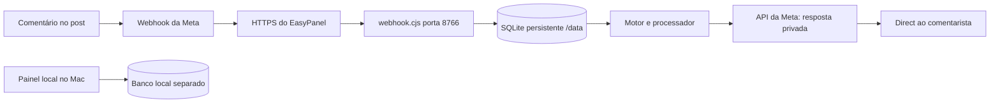

# Manual de construção — Fluxo para Instagram

**Versão da documentação:** 11 de novembro de 2026
**Responsável pelo projeto:** Edilson Morais
**Objetivo:** explicar o que foi construído, como funciona, como operar e como evoluir a ferramenta para várias publicações e gatilhos.

> Este manual descreve o estado conhecido ao fim da sessão. A automação de uma publicação foi testada em condições reais e confirmada pelo usuário. A administração de múltiplas regras é uma **próxima fase**, não um recurso já entregue. Confira a situação real da VPS e da Meta antes de fazer alterações.

## 1. O que é o Fluxo

O Fluxo é uma ferramenta própria de automação de interações no Instagram, inicialmente para os perfis de Edilson. A primeira função recebe um comentário com uma palavra escolhida, identifica a publicação e envia uma resposta privada com o conteúdo configurado.

O objetivo da próxima fase é permitir, por exemplo:

| Publicação | Palavra | Resposta |
| --- | --- | --- |
| Post das aulas gratuitas | `QUERO` | Mensagem com o link das quatro aulas. |
| Outro post | `PANDEIRO` | Outra mensagem e outro link. |
| Um terceiro post | `AULA` | Outra mensagem e outro link. |

Cada automação deverá ser criada, alterada, ativada ou pausada separadamente. **Esses exemplos adicionais ainda não estão implementados na VPS.**

## 2. Situação confirmada

- Perfil profissional: `@suzanoexpress`.
- Publicação ativa: `https://www.instagram.com/p/DfnKnp0hNOM/`; ID de mídia `18093869495691947`.
- ID da conta observado no webhook e no campo `user_id`: `17841407777954952`. A consulta `/me` também retornou outro campo `id`, diferente; não presumir que sejam intercambiáveis.
- Gatilho: `QUERO`. São aceitos `quero`, `Quero!`, `eu quero` e frases que contenham a palavra inteira. O sistema ignora caixa, acentos e pontuação, mas não entende o significado: `não quero` também corresponde. `queria` e `euquero` não correspondem.
- Resposta: mensagem informada pelo usuário, com `https://4-aulas-gratuitas.suzanoexpress.com.br`.
- Hospedagem: VPS Hostinger, EasyPanel, projeto `suzanoblog`, serviço `fluxo-instagram`.
- Repositório privado: `https://github.com/Rota50ia/fluxo-instagram-suzano-2.0`, branch de produção `main`.
- A Meta aceitou o callback; teste fictício e evento real chegaram ao receptor. Um direct direcionado foi aceito e recebido. Depois, o usuário confirmou outro teste totalmente automático.

O estado de execução em tempo real, os prazos das credenciais, backups e permissões devem ser verificados novamente no início da próxima sessão. Não registrar valores secretos.

## 3. Arquitetura existente



O painel local **não está conectado** à fila nem às regras da VPS. Seus botões de ativar e pausar afetam apenas as simulações locais.

### Caminho de uma entrega na VPS

1. A Meta verifica o callback usando o token de verificação. O endpoint responde ao desafio quando os valores correspondem.
2. Uma entrega POST é validada por HMAC SHA-256 usando a chave do aplicativo e o corpo bruto; uma assinatura inválida é rejeitada.
3. Após a verificação, o corpo da entrega é gravado em SQLite antes do retorno de sucesso. O mesmo corpo exato é deduplicado por hash.
4. O processador lê entregas pendentes em lotes e identifica eventos de conta autorizada. No caso atual, somente comentários do post definido que contêm `QUERO` geram uma ação.
5. A ação usa uma chave única de conta e comentário. É marcada como `enviando` antes da tentativa de envio à API da Meta. Uma resposta HTTP bem-sucedida com identificador da mensagem é marcada como `enviada`.
6. Falhas e respostas incertas ficam registradas; não há repetição automática. Se a conexão falhar depois de a Meta aceitar a mensagem, não é seguro repetir sem verificação.

O processo de trabalho roda periodicamente. A situação confirmada usa uma regra e uma conta; não supor que a arquitetura existente já isola múltiplos usuários ou tenha suporte seguro a várias réplicas.

## 4. Mapa dos arquivos

| Arquivo | Responsabilidade |
| --- | --- |
| `webhook.cjs` | Servidor HTTP de callback, verificação da assinatura, gravação de entregas e início do processamento. |
| `processador.cjs` | Criação das ações, prevenção de duplicatas por comentário, estados e chamada à API da Meta. |
| `motor-regras.cjs` | Normalização, interpretação de eventos e escolha da primeira regra compatível. É uma função separada do armazenamento de regras. |
| `controle-ativacao.cjs` | Marco persistente de ativação no modo `auto`. |
| `status-acoes.cjs` | Contagens agregadas no contêiner, sem imprimir conteúdo nem credenciais. |
| `servidor.cjs` | Servidor do painel **local** e banco SQLite do Mac. |
| `index.html`, `app.js` | Interface local de cadastro e simulação; não administra a VPS. |
| `chaves.swift` | Utilitário do Chaves do macOS para guardar manualmente um token local. |
| `localizar-publicacao.cjs` | Consulta de leitura às mídias pela API da Meta usando credencial local, sem imprimi-la. |
| `Dockerfile`, `Dockerfile.webhook` | Imagem do receptor e processador. Não publica o painel local. |
| `verificar*.cjs` | Testes locais e diagnósticos específicos; ver seção 10. |

O diretório `dados/`, `.env`, bancos e arquivos ZIP são ignorados no Git. A allowlist do `.dockerignore` impede que dados e credenciais locais sejam enviados no contexto de build. Qualquer novo módulo exigido pelo contêiner precisa ser incluído no Dockerfile e na allowlist.

## 5. Infraestrutura e configuração

### 5.1 Meta

O app `suzano express atendimento` foi configurado com o caso de uso de mensagens e conteúdo do Instagram, pelo caminho **API com login do Instagram**. O usuário publicou o aplicativo, ativou a assinatura de webhook da conta e realizou os testes. A Meta indicou na interface que a análise poderia ser dispensada para uso nas próprias empresas; não extrapolar esse aviso para clientes ou outras permissões.

O callback informado à Meta é:

```text
https://suzanoblog-fluxo-instagram.7lvlou.easypanel.host/webhook
```

O campo `comments` estava assinado. Outros campos também apareciam assinados. Antes de desativar qualquer um, verifique se outra função ou integração depende dele.

A documentação e as políticas mudam. Antes de implementar novos recursos, confirme endpoint, campos, limites, permissões e elegibilidade na [documentação oficial da API do Instagram da Meta](https://www.postman.com/meta/instagram/documentation/6yqw8pt/instagram-api). Não apresente a validação de uma conta ou um teste como garantia de disponibilidade para todas as pessoas.

### 5.2 EasyPanel

O serviço `fluxo-instagram` usa fonte GitHub, branch `main`, caminho de build `/` e `Dockerfile`. O proxy HTTPS encaminha ao contêiner por HTTP na porta `8766`. O volume `fluxo-dados` é montado em `/data`; o SQLite real fica em `/data/eventos.sqlite`.

**Preservar o volume:** recriar um contêiner não deve significar recriar ou apagar o volume. A existência de montagem foi observada; a existência e a restauração de backup ainda não foram comprovadas. Configure e teste backups adequados para SQLite em WAL, de forma consistente, antes de migrações. Copiar apenas o arquivo principal enquanto o banco está ativo pode não constituir um backup íntegro.

O GitHub pode provocar implantação automática no EasyPanel. Antes de qualquer push ou merge, verifique a configuração efetiva de auto deploy, prepare testes e rollback e considere o impacto no serviço ativo. Uma branch isolada ajuda a desenvolver sem alterar a branch de produção, mas não substitui verificar como o webhook do repositório está configurado.

### 5.3 Configuração do ambiente

As variáveis são definidas na seção Ambiente do EasyPanel. **Não copie seus valores para o Git, chat, capturas ou logs.**

| Variável | Uso atual |
| --- | --- |
| `FLUXO_WEBHOOK_VERIFY_TOKEN` | Token criado pelo operador para o desafio inicial do webhook. |
| `FLUXO_WEBHOOK_APP_SECRET` | Chave usada para validar assinaturas das entregas. |
| `FLUXO_INSTAGRAM_TOKEN` | Token da conta para comunicação com a API. |
| `FLUXO_INSTAGRAM_ID` | ID da conta autorizada. |
| `FLUXO_PUBLICACAO_ID` | ID do único post configurado atualmente. |
| `FLUXO_MENSAGEM` | Mensagem do único fluxo atual. |
| `FLUXO_REGRA_ATIVA` | Liga ou desliga o planejamento. |
| `FLUXO_ENVIO_ATIVO` | Liga ou desliga o envio normal. |
| `FLUXO_ATIVACAO_APOS` | `auto` usa marco persistente; também aceita data UTC ISO com milissegundos. |
| `FLUXO_TESTE_ENVIO`, `FLUXO_TESTE_COMENTARIO_ID` | Teste direcionado, desligado normalmente. |
| `FLUXO_WEBHOOK_PORT`, `FLUXO_WEBHOOK_HOST`, `FLUXO_WEBHOOK_DB` | Porta, interface e caminho do banco do contêiner. |

A palavra `QUERO` é fixa no código atual e **não** tem variável própria. Não edite `FLUXO_PUBLICACAO_ID` ou `FLUXO_MENSAGEM` para tentar acrescentar uma segunda campanha: isso altera a única regra existente.

### 5.4 Marco de ativação

Com `FLUXO_ATIVACAO_APOS=auto`, o serviço marca o horário quando regra e envio ficam ativos juntos. A marca é persistida no banco. Entregas anteriores ao marco são marcadas como processadas sem ação, e ações pendentes antigas dessa conta passam a `ignorada_antes_ativacao`. Reiniciar com a automação ativa preserva o marco. Após uma pausa aplicada e posterior reativação, cria-se outro marco.

Esse controle usa o horário de **recebimento no servidor**, não garante excluir comentário antigo cujo webhook tenha chegado atrasado. Na sessão, o usuário informou que os dois comentários antigos eram de seus próprios perfis. Para tornar “somente novos comentários” uma garantia mais forte, validar horário de criação e elegibilidade na Meta, lidar com eventos sem data e definir comportamento para entregas atrasadas; testar antes de usar em novas campanhas.

## 6. Rodar a prévia no Mac

A prévia serve para desenvolvimento e simulação. Requer Node.js 24 e usa `dados/fluxo.sqlite`.

```bash
cd /Users/edilsonmorais/instagram-automacoes
node servidor.cjs
```

Abra `http://127.0.0.1:8765`. Use `Ctrl+C` para parar. Para reconstruir o auxiliar do Chaves do macOS, se necessário:

```bash
mkdir -p dados
swiftc chaves.swift -o dados/fluxo-chaves
```

Não exponha esse painel local à internet. Seus perfis e regras são independentes do servidor remoto. O arquivo `previa-original.html` é uma versão histórica; a migração do armazenamento antigo do navegador para o banco atual não é automática.

## 7. Operar a automação atual

No EasyPanel, abra `suzanoblog` → `fluxo-instagram` → terminal bash:

```bash
node /app/status-acoes.cjs
```

O comando mostra contagens de entregas e ações, sem mensagens, autores ou tokens. Estados relevantes:

- `pendente`: planejada e aguardando processamento.
- `enviando`: uma tentativa começou; verifique antes de qualquer repetição.
- `enviada`: a API retornou sucesso e identificador da mensagem. A verificação com a conta destinatária continua útil.
- `falhou`: não houve confirmação de sucesso na resposta recebida; examinar o código HTTP/Meta com cuidado, sem exibir segredos.
- `incerta`: o serviço perdeu a confirmação; a mensagem pode ter sido entregue.
- `ignorada_antes_ativacao`: ação pendente anterior ao novo marco, excluída do envio automático.

Para pausar, altere `FLUXO_REGRA_ATIVA` e `FLUXO_ENVIO_ATIVO` para `nao`, salve e implante a configuração no EasyPanel. Confirme nos logs e no ambiente do processo que a pausa foi aplicada. O receptor pode continuar armazenando eventos. Nunca envie captura da seção Ambiente. Verifique os efeitos e o marco antes de reativar. Não use o painel local para pausar a VPS.

## 8. Segurança e dados

1. Não registrar tokens, segredos, senhas, chaves ou códigos de autenticação em arquivos, histórico Git, prints, logs ou chat. Não passar valores secretos em argumentos de comandos ou URLs.
2. A assinatura deve ser conferida no corpo bruto antes de confiar no conteúdo. Testar tanto sucesso como rejeição.
3. Uma captura mostrou a chave do aplicativo e o token de verificação. O usuário informou a troca de ambos e um teste posterior chegou à VPS. Antes de outra alteração de credenciais, verifique o impacto e teste o fluxo. Não reutilizar valores antigos.
4. Dados dos eventos podem incluir autores e textos de interação. O SQLite e backups devem ter acesso restrito, política de retenção e exclusão definidas; atualmente essa política e um backup restaurado **não foram comprovados**.
5. O futuro painel remoto precisa de autenticação, autorização, proteção de sessão, CSRF, gestão segura de segredos e HTTPS. Não publicar `servidor.cjs` atual, pois ele foi projetado para loopback e não implementa autenticação de um painel público.
6. Não apresentar o webhook como painel; expor apenas a rota necessária ao provedor. Não permitir que um usuário veja ou altere regras e dados de outra conta.
7. Investigar métricas e alertas para falha de envio, expiração/revogação do token, indisponibilidade do serviço, espaço em disco, fila acumulada e backup. **Esses alertas ainda não foram implementados.**

## 9. Próxima fase — várias postagens e gatilhos

### 9.1 Resultado esperado

O usuário abre um painel protegido, escolhe um perfil e uma publicação, informa um ou mais gatilhos e a mensagem com link, salva e ativa a regra. Ele pode listar, editar, pausar e retomar cada regra sem alterar diretamente variáveis do EasyPanel. Regras de outras postagens permanecem funcionando.

Evitar exigir ID numérico de mídia quando for possível oferecer uma seleção de posts ou aceitar um link e resolver o ID pela API oficial. Fazer a resolução no servidor, validar que a mídia pertence à conta autorizada e exibir erros compreensíveis. A consulta de mídias já foi usada para localizar o post inicial; paginação, renovação do token e limites devem ser tratados.

### 9.2 Modelo de dados proposto — ainda não implementado

Desenhar e validar uma tabela de regras remotas com, no mínimo:

- ID estável da regra; ID da conta; ID da mídia; gatilho ou lista de gatilhos; mensagem; status; datas de criação, atualização e ativação.
- Armazenamento da versão ou cópia da mensagem na ação, de forma que editar uma regra depois não altere uma mensagem já planejada.
- Identificação da regra e versão que gerou cada ação, sem perder a deduplicação de conta/comentário.
- Registro de pausas, alterações e quem as realizou, conforme o modelo de autenticação adotado.
- Uma estratégia explícita para regras que coincidem na mesma publicação: ordem de prioridade e no máximo uma resposta privada por comentário, a validar conforme as regras vigentes da Meta. O motor atual usa a primeira regra compatível; não depender de uma ordem de banco não especificada.

Esses campos são proposta de arquitetura, não descrição de tabelas já existentes. Determinar como representar vários termos e se um post pode ter múltiplas regras após definir a UX e as restrições da API.

### 9.3 Migração da regra atual

1. Trabalhar em uma branch e ambiente de teste isolados, com dados fictícios; não rodar migração experimental na base real.
2. Inventariar a implantação, o volume, o status das flags e a regra atual sem imprimir valores secretos.
3. Preparar backup consistente e testar restauração. Registrar o commit atualmente implantado e o plano de retorno.
4. Criar migração versionada e idempotente. Importar a regra atual uma única vez, preservando conta, mídia, `QUERO`, mensagem, estado e marco de ativação. Não copiar o token para a tabela de regras.
5. Preservar `entregas`, `acoes`, `controle_ativacao`, a deduplicação histórica e as ações `enviada`, `falhou`, `enviando` e `incerta`. Não apagar nem reenviar automaticamente pendências antigas.
6. Fazer a transição controlada com recurso desligado por padrão ou uma estratégia reversível. Se houver fallback para a configuração anterior, definir qual fonte tem precedência para que a mesma regra não seja executada duas vezes.
7. Verificar que o post existente continua funcionando e que a segunda regra é isolada. Ativar novas regras somente após testes e autorização aplicável.
8. Documentar rollback que preserve dados criados depois da migração. Não propor simplesmente restaurar um backup antigo sobre uma base ativa sem reconciliar eventos e ações posteriores.

### 9.4 Painel remoto

- Construir uma interface simples em português: publicação, gatilho(s), mensagem, link, simulação e estado de cada regra; explicar que salvar, ativar e pausar têm efeitos reais.
- Criar autenticação e autorização adequadas ao uso privado. O servidor de simulação local não é um servidor público seguro.
- Separar acesso administrativo da rota pública de webhook. Não colocar token da Meta no navegador nem em logs.
- Validar entradas no servidor, isolar por conta, prever CSRF e sessões seguras, além de proteção contra usos indevidos e registros de auditoria sem dados desnecessários.
- Mostrar estado operacional real: regra ativa, webhook, falhas, mensagens incertas e necessidade de renovar credenciais. Não indicar sucesso com base apenas no clique do botão.
- Garantir que pausas e alterações sobrevivam a reinícios e sejam aplicadas sem afetar o post existente.

### 9.5 Testes e critérios de aceite

A próxima fase estará pronta quando:

1. For possível configurar pelo menos **duas publicações** com palavras e mensagens diferentes e mantê-las ativas simultaneamente.
2. `QUERO`, `Quero!` e `eu quero` corresponderem onde esperado; palavras parciais não acionarem. Documentar a ausência de interpretação de negação e as variantes que não correspondem.
3. Cada publicação acionar apenas suas próprias regras; perfil, mídia e ID do evento serem validados. Quando o campo essencial faltar, a regra específica deve falhar de forma segura.
4. Pausar uma regra não afetar outra; reiniciar e atualizar o contêiner preservarem dados e estado.
5. Entregas duplicadas, em lotes diferentes e em ordens diferentes não gerarem respostas duplicadas. Concorrência deve ser testada conforme a quantidade de réplicas permitida.
6. Falhas de Meta, timeouts, resposta perdida e interrupção durante envio ficarem visíveis, sem repetição automática insegura.
7. A regra original migrada continuar funcionando e o rollback preservar histórico e dados novos.
8. O painel exigir autenticação e autorização, proteger segredos e não expor dados dos eventos publicamente.
9. A versão for validada com eventos fictícios e depois com contas autorizadas, primeiro com envio controlado e por fim com autorização para ativação real.
10. Houver instruções de operação, retenção e backup/recuperação testadas, além de limites e pendências comunicados ao usuário.

## 10. Testes existentes

Na pasta do projeto:

```bash
node verificar-motor.cjs
node verificar-processador.cjs
node verificar-ativacao.cjs
node verificar-webhook.cjs
node verificar.cjs
```

Os três primeiros usam dados fictícios locais. Os dois últimos iniciam servidores locais em portas de teste e bancos temporários; o ambiente pode exigir permissão para abrir portas. Não executam envios reais. Leia os testes antes de alterá-los e garanta que credenciais de produção não sejam herdadas por testes que simulem o serviço.

Em 11/11/2026, os testes do motor, processador e ativação foram executados novamente com sucesso nesta revisão. O teste do webhook e do painel tinha passado na sessão anterior; não foram executados novamente nesta revisão. A consulta HTTPS sem token ao webhook retornou 403, como esperado. Essas verificações não substituem um teste real após mudança.

## 11. Entrega e retorno

Antes de propor implantação: revisar diff e exclusões do Git, testar a migração em cópia isolada, garantir backup restaurável, preparar configuração e rollback e explicar exatamente o que será alterado. Como o EasyPanel pode implantar automaticamente, não presumir que push seja apenas uma operação de documentação.

Depois da implantação autorizada: confirmar logs, volume, marco, regras e fila sem expor segredos; fazer um teste controlado e confirmar a chegada na conta destinatária. Não marcar o trabalho como completo com base apenas em um deploy verde.

Para retomar, comece por [Handoff](HANDOFF.md) e [Estado atual](ESTADO-DO-PROJETO.md). Para consulta rápida do serviço em funcionamento, use [Operação](OPERACAO-DA-AUTOMACAO.md).
